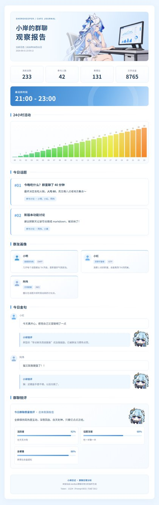

本项目基于 [daily-analysis-report-theme](https://github.com/lingyun14beta/daily-analysis-report-theme)
修改，是适用于 AstrBot「群聊日常分析」插件的个人自用报告模板。
> 效果：
> 
>
> 完整长图见 [点击查看](assets/shore-analysis-report-demo.jpg)。


##安装

在插件 Web 控制台 → 配置页 → 模板选择器旁「安装模板」→ GitHub 链接页签：

```
https://github.com/Kitorinn/shore-analysis-report-theme
```

插件会自动下载源码、识别 `shore-analysis-report/` 模板目录并安装，**无需重启机器人**。
也可以在本仓库页面点 `Code ▾ → Download ZIP`，然后在「安装模板 → 上传 zip」直接上传。

> 安装成功后模板会出现在「断点续跑」「免 Token 切换主题重绘」下拉中；
> 卸载请用同一入口旁的「卸载模板」（内置模板不可卸载）。

##目录结构

```
shore-analysis-report-theme/
├── README.md
├── LICENSE
├── AGENTS.md
├── generate_preview.py
├── verify_demo.py
├── assets/
│   ├── shore-analysis-report-demo.jpg
│   └── shore-analysis-report-demo-thumb.jpg
└── shore_analysis_report/
```
